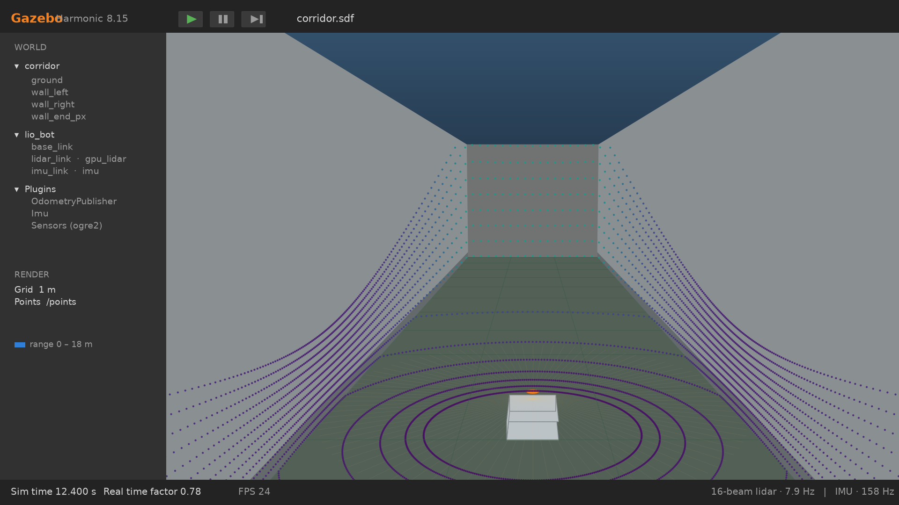
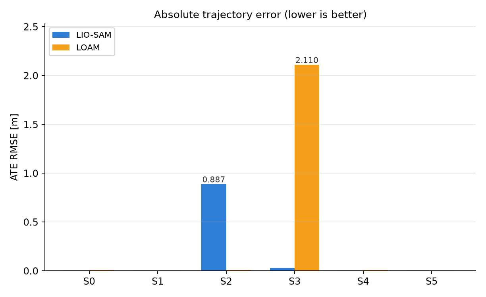
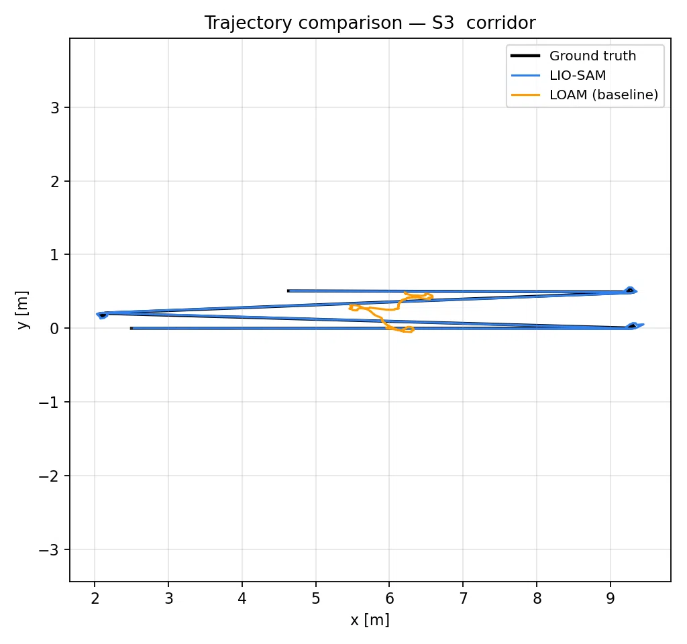
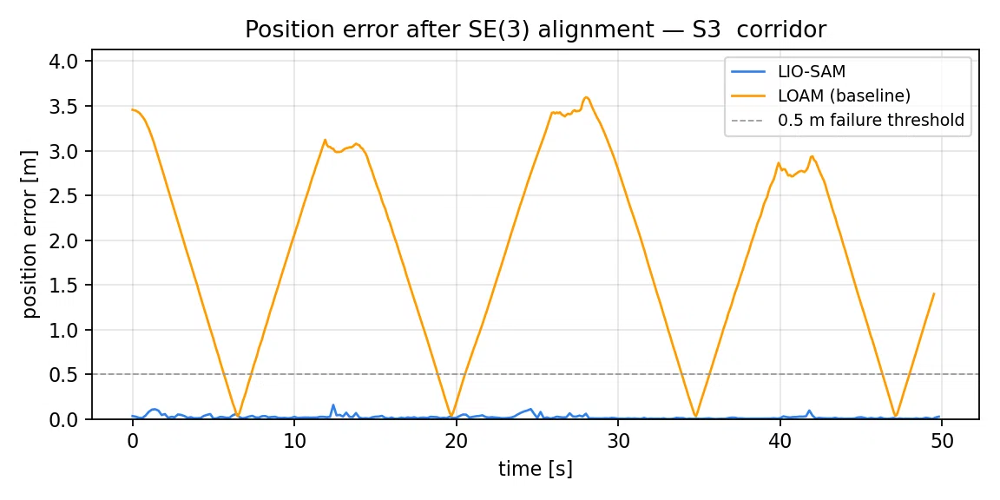

# LOAM vs LIO-SAM: pure geometry against IMU fusion, on identical data

One small robot with a 16-beam lidar and a 9-axis IMU drives a room and a corridor in
Gazebo. Each scenario is **recorded once**, then that same bag is replayed into
[LIO-SAM](https://github.com/TixiaoShan/LIO-SAM) and into
[A-LOAM](https://github.com/G-Apple1/A-LOAM-ROS2) — a ROS 2 port of LOAM — and the two
trajectories are scored with the same metric.

The short answer:

> **Where geometry stops providing six degrees of freedom, LIO-SAM holds ATE at 0.03 m
> where the LOAM baseline drifts to 2.11 m — a 6837 % gap. Where geometry is rich
> both algorithms sit in the millimetre-to-centimetre range, so the IMU buys little
> (S0: +102 %, S1: +44 %).**

| Scenario | LOAM | LIO-SAM | Gap |
|---|---|---|---|
| S0 nominal motion | 0.0095 m | **0.0047 m** | **+102.4 %** |
| S1 fast yaw | 0.0051 m | **0.0035 m** | **+44.1 %** |
| **S3 corridor degeneracy** | **2.1095 m** | **0.0304 m** | **+6837 %** |
| S4 sparse hall | 0.0105 m | **0.0044 m** | **+141.3 %** |
| S5 long run, 180 s | **0.0042 m** | 0.0052 m | −22.0 % |
| **S2 high speed** | **0.0112 m** | 0.8868 m | **−7799 % (anomaly, §7)** |

> **How the comparison is expressed.** The gap is the difference divided by whichever of
> the two errors is smaller — that is, "how much worse is the loser than the winner":
>
> `gap = (ATE(worse) − ATE(better)) / ATE(better) × 100 %`
>
> Positive means LIO-SAM is the more accurate of the two, negative means it lost to the
> LOAM baseline. So S3 reads "LOAM's error is 6837 % larger" and S5 reads "LIO-SAM's error
> is 22.0 % larger". Computed from the CSV at full precision; recomputing from the four
> decimals printed in the table reproduces these to within a few percent (S3 → 6933 %,
> S4 → 138.6 %, S5 → −23.8 %).

> ATE RMSE, defined in §3. Every number comes from
> [`results/tables/all_runs.csv`](results/tables/all_runs.csv), written by the evaluation
> script; nothing in this repository is typed in by hand.



---

## 1. Runtime environment

| Item | Measured |
|---|---|
| Hardware | NVIDIA **Jetson Orin Nano 8 GB** (aarch64) |
| OS / ROS | Ubuntu **24.04 LTS** + **ROS 2 Jazzy** |
| Simulator | **Gazebo Harmonic 8.15** via `ros_gz`, RViz2 |
| LIO-SAM | upstream `ros2` branch, C++17, **GTSAM 4.2** (iSAM2) + Ceres 2.2 |
| A-LOAM | ROS 2 port at a pinned commit, **laser only, no IMU** |
| Real-time factor | **0.78** — one board runs the simulator and both pipelines, so every sensor delivers ~78 % of its nominal rate |

**The robot** ([`models/lio_bot/model.sdf`](ros2_ws/src/lio_sam_gz_bringup/models/lio_bot/model.sdf)):

| Item | Value |
|---|---|
| Body | 0.50 × 0.34 × 0.12 m, 6.1 kg all-up |
| Wheels | r = 0.10 m, track 0.40 m |
| LiDAR | 16 × 360°, 10 Hz, ±15°, 0.2–40 m, topic `/points_raw` |
| IMU | 200 Hz, 9-axis, topic `/imu_raw` |
| Mounting | LiDAR and IMU **co-located, co-oriented** — the extrinsic is the identity |
| Ground truth | `OdometryPublisher` plugin → `/gt/odom`, ~80 Hz |

> Truth comes from the simulator itself rather than from a noisy sensor, so ATE measures
> the algorithm and not the reference.

## 2. How the comparison is built: record once, replay twice



```
              ┌── 2a replay → LIO-SAM (lidar + IMU + factor graph)
1 record once ┤
  Gazebo→bag  └── 2b replay → LOAM (lidar only, the baseline)
                                                    ↓
                                        3 localisation: one 6-DoF pose per sweep → CSV
                                                    ↓
                                        4 analysis: ATE / RPE / robustness / rate
```

**Why it is built this way.** Both algorithms consume the *same bag*: the point clouds are
byte-identical, so a difference in the table cannot come from a difference in the data.
That is the premise the whole comparison rests on.

`ros2 bag play --clock` feeds both pipelines, and `traj_recorder` writes each algorithm's
poses next to the interpolated ground truth — one CSV per scenario and algorithm. Scoring
happens only at the end.

Three rules that are not negotiable:

- Ground truth is interpolated (lerp + slerp) onto every lidar stamp, and the **12 cm
  lidar-to-base lever arm is compensated explicitly**.
- **Thresholds are fixed before measuring** — the 0.5 m failure line, the improvement
  criteria — never tuned after seeing the result.
- A sanity check rejects runs that are **truncated, suspiciously identical, or replayed
  from mismatched offsets**. All three otherwise masquerade as results.

## 3. The metric: how ATE is computed

**ATE — Absolute Trajectory Error.** Each estimator starts at its own origin, so the
first step is a rigid alignment; only then are the per-pose differences meaningful.

**① Pair the poses in time** — one-to-one matches only.

**② Solve the rigid transform** (least squares, closed form):

```
p̄  = mean(p_gt)          p̂̄ = mean(p_est)
H  = Σ (p̂ᵢ − p̂̄)(pᵢ − p̄)ᵀ           cross-covariance of the centred point sets
H  = U Σ Vᵀ   ⇒   R = V·diag(1, 1, det(VUᵀ))·Uᵀ ,   t = p̄ − R·p̂̄
```

- the `det` term forbids a **mirrored** solution (a determinant of −1 is a reflection,
  not a rotation);
- **no scale is fitted**: a trajectory 10 % too large must not be "aligned" into agreement.

**③ Residuals and the number**:

```
eᵢ  = ‖ pᵢ − (R·p̂ᵢ + t) ‖₂
ATE = √( (1/N) Σ eᵢ² )
```

RMSE rather than the mean, so one bad stretch cannot hide behind many good ones. Metres;
lower is better.

Also reported: the rotation part of ATE, RPE over 1 s windows, endpoint error, **the count
of poses beyond 0.5 m**, output rate, and the **raw RMSE before alignment** (which shows
absolute drift rather than the aligned error).

## 4. Six scenarios

Each one changes a single variable:

| Scenario | World | Path | Motion | What it isolates |
|---|---|---|---|---|
| **S0** nominal | 12 × 12 m room | 36 m | circle at 0.40 m/s | baseline: geometry is rich |
| **S1** fast yaw | 12 × 12 m room | 27 m | ω = 0.90 rad/s | **motion distortion** inside one sweep |
| **S2** high speed | 12 × 12 m room | 48 m | 1.2 m/s + 90° in-place turns | large displacement between sweeps |
| **S3** corridor | 30 × 3 m corridor | 29 m | back and forth along the axis | **geometric degeneracy**: 2 DoF unobservable |
| **S4** sparse hall | 20 × 20 m, 6 pillars | 36 m | r = 3 m circle | few features per sweep |
| **S5** long run | 12 × 12 m room | 72 m | 9 laps, 180 s | accumulation |

Scenario definitions live in [`experiments/scenarios/`](experiments/scenarios). Before
anything is recorded, an **offline kinematic + collision pre-check** rejects a scenario
that would clip a wall — a collision makes the ground truth jump, and that data can
neither vindicate nor indict an algorithm.

## 5. Results

The full twelve rows (6 scenarios × 2 algorithms) are in
[`results/tables/all_runs.csv`](results/tables/all_runs.csv), with a Markdown rendering in
`results/tables/all_runs.md` and the sanity report in `results/tables/sanity.txt`.
The raw trajectories behind those numbers are in `results/raw/<scenario>/<algorithm>.csv`
(not tracked — rerun the benchmark and they reappear).



## 6. Key finding: geometric degeneracy is where the IMU is required

Two of the four corridor walls are parallel to the direction of travel, so **translation
along the axis and yaw are close to singular in the scan-to-map Jacobian**. The
consequence:

| S3 metric | LOAM | LIO-SAM |
|---|---|---|
| ATE RMSE | 2.110 m | **0.030 m** |
| ATE rotation | 12.6° | **0.7°** |
| Endpoint error | 1.40 m | **0.027 m** |
| Poses beyond 0.5 m | **429 / 508** | **0** |



The orange trace (LOAM) covers a fraction of the corridor; the blue one (LIO-SAM) covers
all of it. **LOAM's estimated path is 18 % of the true length** — it does not drift away
from the corridor, it never travels along it: with no information in x, the solver keeps
whatever its initial guess said. The error curve says the same thing from the other side:
it resets every time the robot turns round, swinging between 0 and 3.6 m.

That is precisely what the IMU supplies — the two directions the corridor removes.

## 7. One anomaly: the high-speed scenario

| S2 metric | LOAM | LIO-SAM |
|---|---|---|
| ATE RMSE | **0.011 m** | 0.887 m |
| RPE translation | 5.4 %/m | 121 %/m |
| Poses beyond 0.5 m | 0 | **282 / 282** |

**The same bag replayed at a different rate gives 0.040 m instead of 0.887 m**, so the
result is not stable. Message loss or gaps in the IMU preintegration under high dynamics
are plausible causes — **we have not isolated it and we do not claim to.**

It is reported rather than buried because a comparison that ends on its favourable
scenarios is advertising, not measurement. It sits next to the headline numbers, not in an
appendix.

## 8. Reproduce

Requires Ubuntu 24.04, ROS 2 Jazzy and Gazebo Harmonic — a Jetson or an ordinary x86
machine.

```bash
# 1) dependencies + both upstream algorithms + patches + build (~5 min, once)
bash setup/install_deps.sh

# 2) offline self-check: no ROS needed, ~50 s
bash setup/check_all.sh          # or: make check

# 3) the full experiment: 6 scenarios × 2 algorithms (~35 min)
bash experiments/run_bench.sh    # or: make bench
```

Step 3 runs the scenario pre-check, records each scenario in Gazebo, replays it into both
algorithms, evaluates, plots, sanity-checks the numbers and writes a manifest:

| Output | Contents |
|---|---|
| `results/tables/all_runs.csv/.md` | the twelve-row table |
| `results/tables/sanity.txt` | the sanity verdict; `0 FAIL` is the bar for using the numbers |
| `results/figures/` | trajectory overlays, error curves, ATE bar chart, six-panel overview |
| `results/raw/<scenario>/<algorithm>.csv` | raw trajectories, for re-checking |
| `results/manifest.json` | provenance: commit, host, bag sizes, row counts |

**Verifying one link of the chain instead of all of it:**

```bash
# record only, no algorithms
bash experiments/run_bench.sh --record-only --record

# reuse the recorded bags, run algorithms + evaluation only
bash experiments/run_bench.sh --replay-only --rate 0.5

# one scenario, one algorithm
bash experiments/run_bench.sh --scenarios s3_corridor --replay-only --algo liosam
```

> `--rate` is the replay pacing. With a real-time factor of 0.78, 0.5–0.7 gives both
> algorithms enough CPU; too fast and LIO-SAM starts dropping messages — one of the
> suspected causes behind the anomaly in §7.

**Regenerating the report material** (needs `python3` + `matplotlib` + `python-pptx`):

```bash
python3 report/make_part3_figures.py   # six scenario maps + the ATE illustration
python3 report/make_ate_formula.py     # typeset formulas
python3 report/make_gazebo_view.py     # the S3 Gazebo-style view
python3 report/build_deck.py           # the 20-page English comparison deck
```

> `report/build_part3.py` fills these results into the course template and expects
> `report/AAE4203_temp.pptx` to be present locally. Generated decks are not tracked
> (see `.gitignore`).

## 9. Repository layout

```
.
├── Makefile                    # make check / bench / deck / clean
├── demo.repos                  # pinned versions of both upstream algorithms (vcstool)
├── setup/                      # install, patches, 7 self-check suites (190+ checks)
├── experiments/                # scenario definitions, benchmark runner, sanity, metrics
├── report/                     # report generators (the decks themselves are not tracked)
├── ros2_ws/src/
│   ├── lio_sam_gz_bringup/     # worlds, robot model, bridge, sensor-format conversion
│   └── lio_sam_bench/          # ground-truth sync, trajectory recorder, evaluation, plots
├── results/tables/             # measured results (tracked, as evidence)
└── docs/                       # documentation index, troubleshooting, images
```

## 10. Documentation and known issues

| Document | What it is for |
|---|---|
| [`docs/README.md`](docs/README.md) | one-page index: layout, commands, conventions |
| [`docs/TROUBLESHOOTING.md`](docs/TROUBLESHOOTING.md) | **look here first when something breaks** — symptom → cause → fix |
| [`docs/LIO-SAM-intro-and-roadmap.md`](docs/LIO-SAM-intro-and-roadmap.md) | how LIO-SAM works, and the path to running it here |
| [`experiments/README.md`](experiments/README.md) | experiment protocol and caveats |

Known issues, in one line each (the details are in the troubleshooting guide):

- **Static transforms must use wall time** (`use_sim_time:=False`). On sim time they wait
  for `/clock` and arrive after the first point clouds, so the extrinsic lookup fails.
- **`baselinkFrame` must equal `lidarFrame`.** Otherwise tf2 routes the lookup through
  `odom`, whose buffer starts later, and IMU initialisation fails — the GTSAM
  rank-deficiency crash is a downstream symptom, not the cause.
- **Parameters and launch files load from `install/`.** Editing a source file without
  `colcon build` changes nothing; the runner now checks this and says so.
- LIO-SAM's `mappingProcessInterval: 0.15` means it processes **every second cloud** at
  8 Hz — by design, not for lack of CPU.

## References

- Shan, T., Englot, B., Meyers, D., Wang, W., Ratti, C., & Rus, D. (2020).
  *LIO-SAM: Tightly-coupled Lidar Inertial Odometry via Smoothing and Mapping.* IROS.
- Zhang, J., & Singh, S. (2014). *LOAM: Lidar Odometry and Mapping in Real-time.* RSS.
- Dellaert, F. *GTSAM* — https://github.com/borglab/gtsam
- A-LOAM (ROS 1) — https://github.com/HKUST-Aerial-Robotics/A-LOAM
- A-LOAM ROS 2 port — https://github.com/G-Apple1/A-LOAM-ROS2

---

MIT License · course project, AAE4203 Guidance and Navigation
